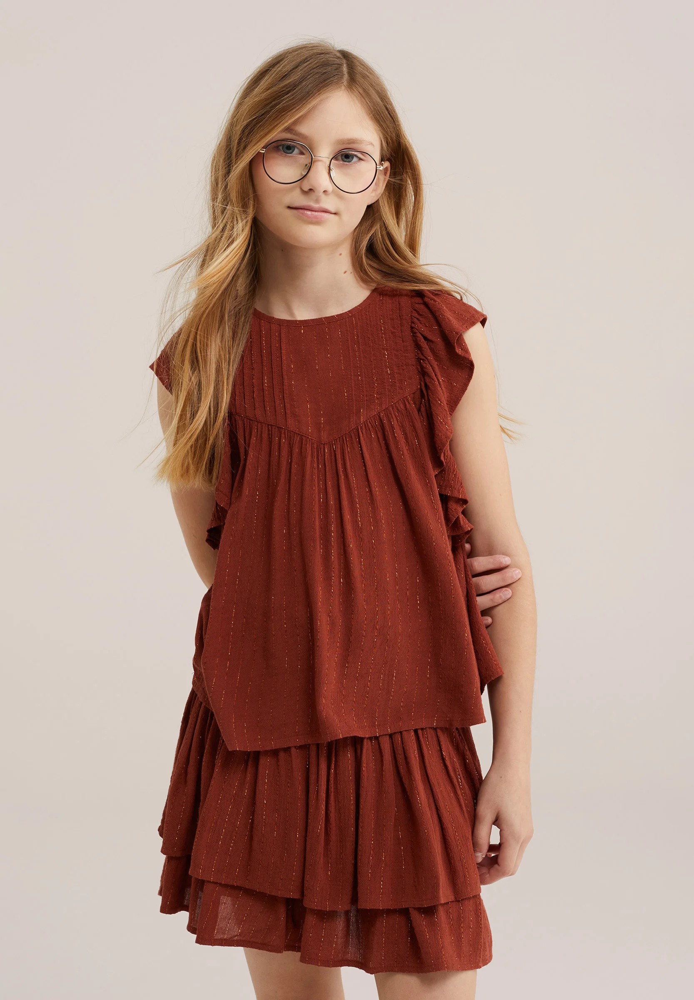
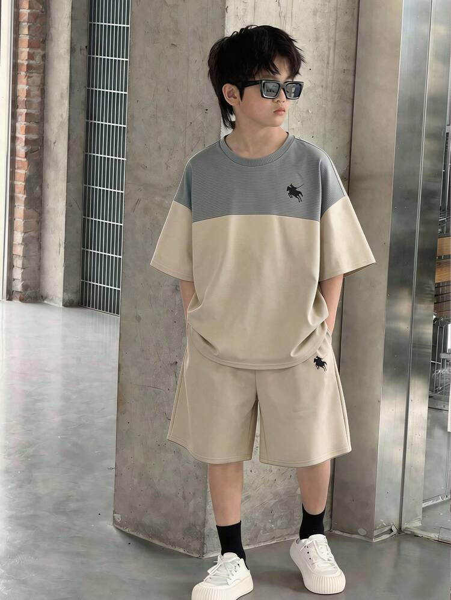
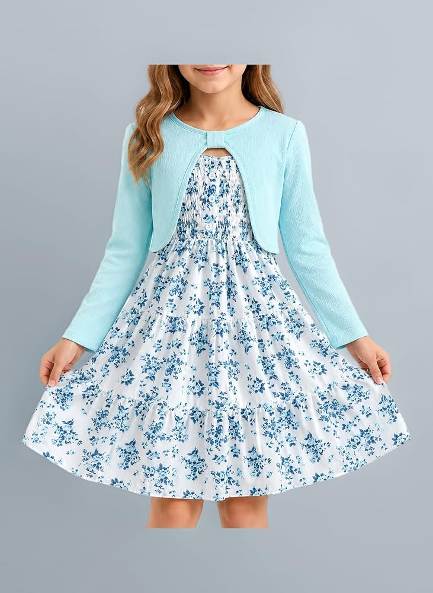
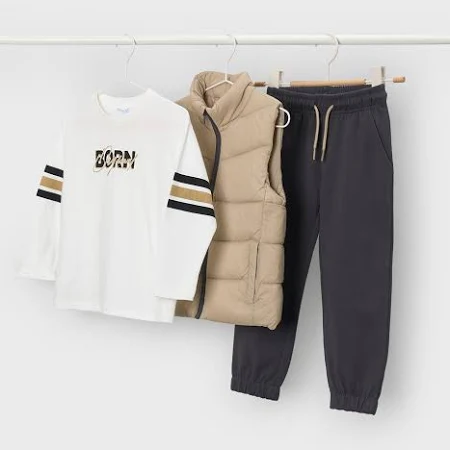

# FICHA TECNICA: Littel Tous

En este documento vamos a recopilar la informacion empresarial de nuestra empresa como lo seria los datos corporativos de Littel Tous, su catalogo y sus clientes.

## Datos corporativos 
En este apartado detallaremos los datos legales de nuestra empresa.

- **Nombre comercial:** Littel Tous
- **NIF:** B-98765432
- **Sector:** Moda, Calzado y Complementos Infantiles (0 a 14 años)
- **Dirección:** Calle Greco, 10, 41007 Sevilla (España)
- **Teléfono:** +34 947 293 422
- **Sitio Web:** https://ww.littletoes.es
- **Email:** LTOffi@littletous.es

---
## Catálogo
Nuestra empresa es de moda infantil (0 - 14 años) y aqui podemos ver la variedad de productos que tiene nuestra empresa. 

### 1. Set de Punto Bebé Recién Nacido
- **Imagen**

- **Descripción:** Conjunto de punto compuesto de chaqueta, pantalones gorro y patucos.
- **Tipo de producto:** Almacenable *(Stock inicial en Odoo: 30 unidades)*
- **Precio Venta:** 25,00 € | **Coste:** 12,00 €

### 2. Pack Recien Nacido Elephant 
- **Imagen**

- **Descripción:** Conjunto de pijama, pelele, camisera, gorrito, babero y patucos de algodon con estanpados de elefantes.
- **Tipo de producto:** Almacenable *(Stock inicial en Odoo: 20 unidades)*
- **Precio Venta:** 30,99 € | **Coste:** 15,00 €

### 3. Conjunto Blusa Terracota y Falda
- **Imagen**

- **Descripción:** Blusa sin mangas con volantes laterales y falda a capas a juego en tono terracota con detalles de hilo brillante.
- **Tipo de producto:** Almacenable *(Stock inicial en Odoo: 15 unidades)*
- **Precio Venta:** 18,00 € | **Coste:** 9,00 €

### 4. Conjunto Deportivo Bicolor Niño
- **Imagen**

- **Descripción:** Camiseta de manga corta amplia con parte superior gris y beige inferior, junto con pantaló corto beige a juego.
- **Tipo de producto:** Almacenable *(Stock inicial en Odoo: 25 unidades)*
- **Precio Venta:** 28,00 € | **Coste:** 14,00 €

### 5. Vestido Floral azul
- **Imagen**

- **Descripción:** Vestido blanco con estanpado de flores axuler y falda de volantes.
- **Tipo de producto:** Almacenable *(Stock inicial en Odoo: 10 unidades)*
- **Precio Venta:** 20,00 € | **Coste:** 10,00 €

### 6. Conjunto Sport 3 Piezas 
- **Imagen**

- **Descripción:** Conjunto que incluye sudadera blanca larga con testo "BORN" y bandas en los brazos, chaleco acolchado beige y pantalón de chándal gris oscuro.
- **Tipo de producto:** Almacenable *(Stock inicial en Odoo: 30 unidades)*
- **Precio Venta:** 45,00 € | **Coste:** 22,00 €

---
## Clientes
En este apartado podemos ver nuestra cartelera de clientes. Como podeis ver tenemos dos tipos de clientes empresiarales y personales.
Estos clientes nos muestra dos diferentes de compras como lo serian una empresa que compra al por mayor y un cliente final que la venta es directamente para el que esta pensado el producto. 

### 1. Cliente Empresa (B2B)

- **Nombre:** Escuela Infantil Los Pitufos S.L.
- **NIF/CIF:** ESA12345674
- **Dirección:** Av. de la Innovación, 4, 41020 Sevilla
- **Email:** compras@eipitufos.es
- **Teléfono:** 954 23 45 75

### 2. Cliente Personal (B2C)

- **Nombre:** Maria Martínez Ruiz
- **NIF/CIF:** ESA12345674
- **Dirección:** Calle Primavera, 15, 41009 Sevilla
- **Email:** maria.mr@gmail.com
- **Teléfono:** 600 12 43 54